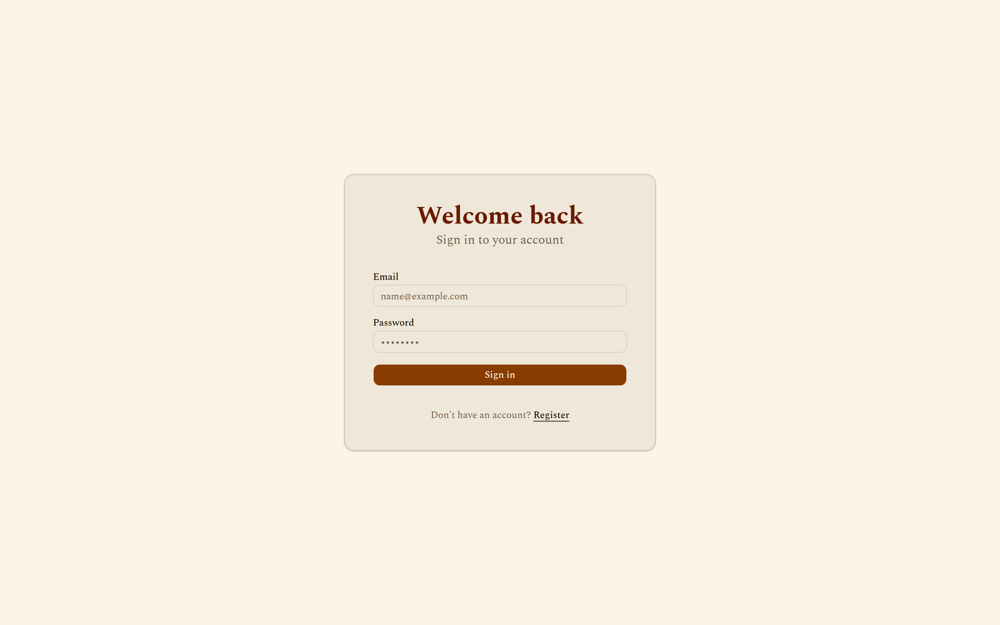
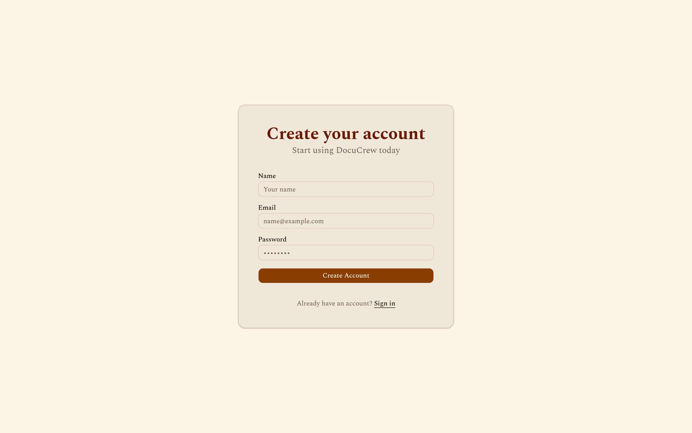
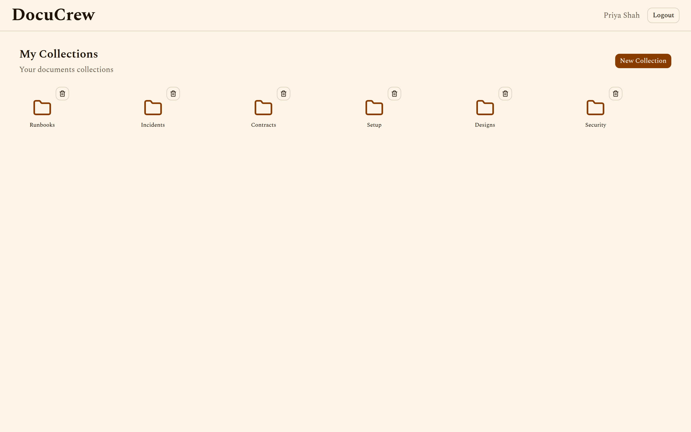
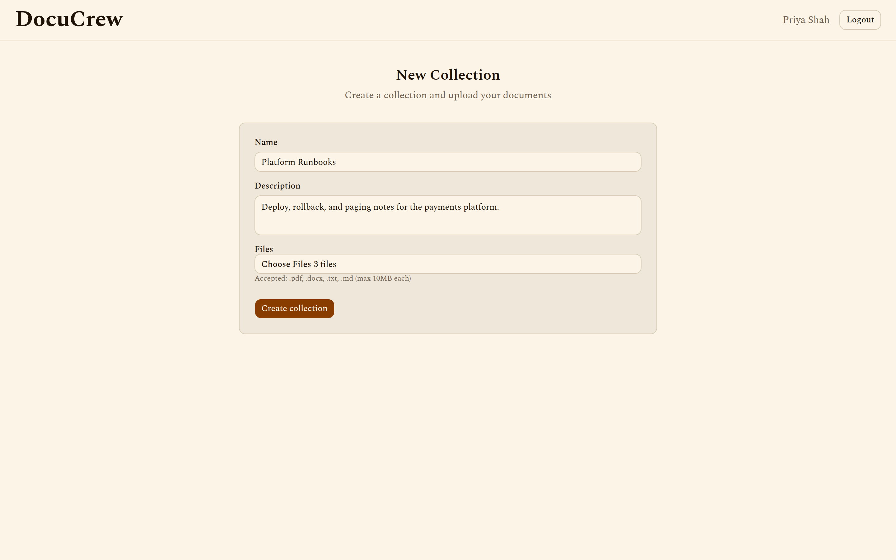
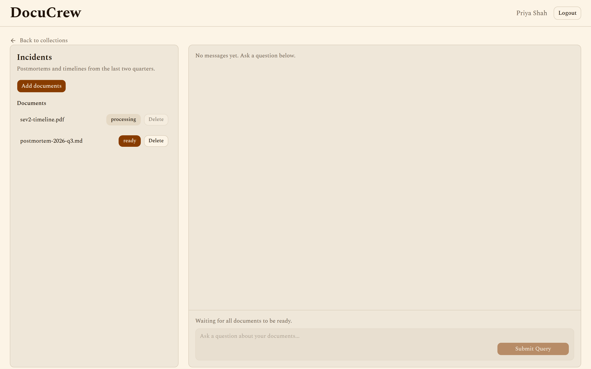
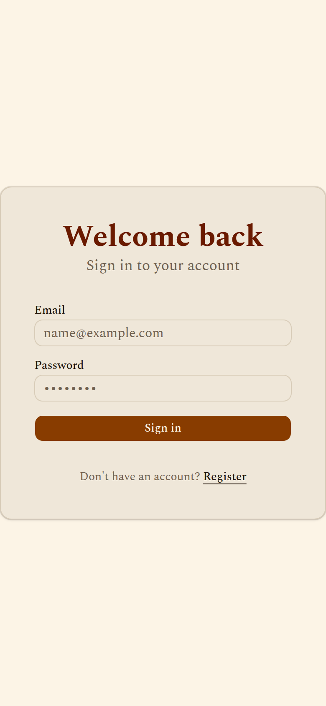
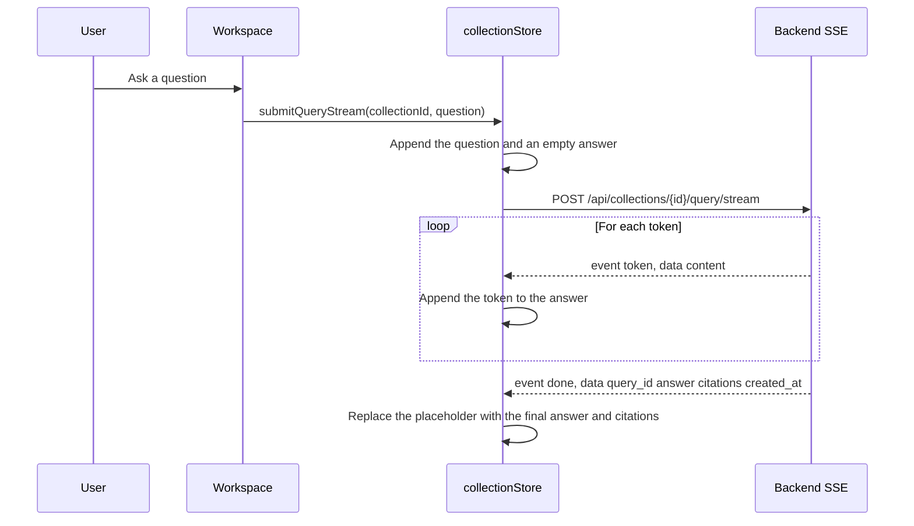

<div align="center">

# DocuCrew — Frontend

### A multi-document workspace where a CrewAI crew answers questions over your files, streamed with citations

<p>
  
  
  
  
  
  
  
</p>

<sub>Frontend repository · <a href="https://github.com/raosam23/docucrew-backend">Backend repository →</a> · <a href="https://github.com/raosam23/docucrew-infra">Infra repository →</a></sub>

</div>

---

## Screenshots

Real screens from this frontend, at a 1440×900 desktop viewport (login is also shown at a 390×844 phone width). The payments runbooks are sample copy: REST responses and the query SSE stream are intercepted in the browser, so the images can be regenerated without the backend. See [Refreshing the screenshots](#refreshing-the-screenshots).

<table>
  <tr>
    <td width="50%" align="center" valign="top">
      
      <br />
      <sub>Sign in</sub>
    </td>
    <td width="50%" align="center" valign="top">
      
      <br />
      <sub>Create an account</sub>
    </td>
  </tr>
</table>

**Collections** — signed in as Priya Shah, with a folder for each document collection.



**New collection** — name, description, and three documents selected for upload.



**Ingestion** — one document is still processing, so the chat stays closed until every file is ready.



**Answer** — an earlier question stays in the thread, and the new answer streams in with its sources open.


**Phone** — the login card at a 390px-wide viewport.

<p align="center">
  
</p>

---

## Table of Contents

- [Screenshots](#screenshots)
- [What is DocuCrew?](#what-is-docucrew)
- [Features](#features)
- [How streaming works](#how-streaming-works)
- [Tech stack](#tech-stack)
- [Project structure](#project-structure)
- [Getting started](#getting-started)
- [Environment variables](#environment-variables)
- [Scripts](#scripts)
- [Refreshing the screenshots](#refreshing-the-screenshots)

---

## What is DocuCrew?

DocuCrew is a multi-document intelligence app. You group files into collections, the backend ingests them into a vector store, and a CrewAI crew answers plain-language questions with citations.

This is the **frontend repository**. It talks to the [DocuCrew backend](https://github.com/raosam23/docucrew-backend), which runs the ingestion crew, the query crew, retrieval, and storage. Deployment for the pair lives in [docucrew-infra](https://github.com/raosam23/docucrew-infra).

On the query crew, a retriever searches the collection, a cross-reference agent and a gap analyst read across the chunks, and a synthesizer writes the final answer. This UI streams that answer token by token and attaches the citation chips when the stream finishes.

---

## Features

- **Accounts** — register, sign in, and log out. The access token stays in an httpOnly `access_token` cookie. Zustand keeps the user object.
- **Collections** — create, open, and delete collections from the dashboard.
- **Uploads** — PDF, DOCX, TXT, and Markdown, up to 10MB each. Creating a collection uploads its files before opening the workspace.
- **Ingestion status** — each document shows `pending`, `processing`, `ready`, or `failed`. Chat stays disabled when a collection has no documents, and until every document is `ready`.
- **Streaming answers** — questions go to `POST /api/collections/{id}/query/stream`. Tokens append live, and the composer shows a rotating status word while the crew works.
- **Citations** — each answer can expand into source chips: filename, chunk number, and relevance.
- **Thread history** — earlier questions for that collection load in the same panel.
- **Light theme** — warm sand and amber tokens in `globals.css`, set in the Spectral typeface.

---

## How streaming works

JSON calls go through ky with `credentials: "include"`. The query stream uses `fetch`, because a long SSE response is a poor fit for ky's timeout. The workspace calls `submitQueryStream` in `collectionStore`.



The backend also emits `event: status` when the crew starts, and `event: error` on failure. This client ignores `status` and throws on `error`. The rotating label (`Searching`, `Answering`, and the rest of the lists in `src/lib/constants.ts`) is local: it runs while `streamingPhase` is `THINKING`, then `STREAMING` after the first token.

The `done` payload matches `QueryHistory`: `query_id`, the full `answer`, `citations` (`filename`, `chunk_index`, `relevance_score`), and `created_at`.

---

## Tech stack

| Layer | Choice |
| ----- | ------ |
| Framework | Next.js 16 (App Router, React 19) |
| Language | TypeScript 5 |
| Styling | Tailwind CSS v4 |
| UI components | shadcn/ui (`radix-nova`) on Radix |
| State | Zustand 5 |
| HTTP | ky 2 for JSON (`credentials: "include"`); `fetch` for SSE |
| Notifications | notistack |
| Icons | lucide-react |
| Loading | ldrs |
| Font | Spectral (next/font) |
| Package manager | Bun |

---

## Project structure

```
src/
├── app/
│   ├── (auth)/
│   │   ├── login/page.tsx
│   │   └── register/page.tsx
│   ├── (app)/
│   │   ├── layout.tsx                 # Auth guard, top nav, logout
│   │   ├── dashboard/page.tsx
│   │   └── collections/
│   │       ├── new/page.tsx
│   │       └── [id]/page.tsx          # Documents plus streaming chat
│   ├── globals.css
│   ├── layout.tsx
│   └── page.tsx                       # Redirects / to /dashboard
├── components/
│   ├── chat/QueryThinkingWord.tsx
│   ├── collections/CollectionCard.tsx
│   ├── loading/
│   ├── providers.tsx
│   └── ui/                            # shadcn components
├── lib/
│   ├── api.ts                         # ky client
│   ├── constants.ts                   # Thinking and streaming labels
│   └── utils.ts
├── stores/
│   ├── authStore.ts
│   └── collectionStore.ts             # Collections, documents, history, SSE
└── types/index.ts
```

| Path | Auth | What it does |
| ---- | ---- | ------------ |
| `/` | — | Redirects to `/dashboard`. |
| `/login` | Public | Email and password, then the dashboard. |
| `/register` | Public | Name, email, and password. Register signs you in. |
| `/dashboard` | Guarded | Lists collections. New Collection, and delete from the card. |
| `/collections/new` | Guarded | Creates a collection and uploads PDF, DOCX, TXT, or MD. |
| `/collections/[id]` | Guarded | Document list and the streaming thread. |

The app layout calls `GET /api/auth/me` on mount and sends a failed check to `/login`. Logout is `POST /api/auth/logout`.

### Backend routes this UI calls

| Action | Method and path |
| ------ | --------------- |
| Register | `POST /api/auth/register` |
| Login | `POST /api/auth/login` |
| Current user | `GET /api/auth/me` |
| Logout | `POST /api/auth/logout` |
| List or create collections | `GET` or `POST /api/collections/` |
| One collection | `GET` or `DELETE /api/collections/{id}` |
| List or upload documents | `GET /api/collections/{id}/documents`, `POST /api/collections/{id}/documents/` |
| Delete a document | `DELETE /api/collections/{id}/documents/{document_id}` |
| Thread history | `GET /api/collections/{id}/history` |
| Ask (non-streaming, available on the store) | `POST /api/collections/{id}/query` |
| Ask (what the workspace uses) | `POST /api/collections/{id}/query/stream` |

---

## Getting started

DocuCrew needs both repositories. This frontend expects the [backend](https://github.com/raosam23/docucrew-backend) on `http://localhost:8000`. Start that first, with `ALLOWED_ORIGINS` including `http://localhost:3000`. The backend needs its LLM keys before a live query will succeed.

### Prerequisites

- [Bun](https://bun.sh/) — `curl -fsSL https://bun.sh/install | bash`
- The DocuCrew backend running locally

### Clone and install

```bash
git clone https://github.com/raosam23/docucrew-frontend
cd docucrew-frontend
bun install
```

### Configure

```bash
cp .env.example .env.local
```

`.env.local`:

```env
NEXT_PUBLIC_API_URL=http://localhost:8000
```

The client appends paths such as `api/auth/login`, so this value is the origin only.

### Run

```bash
bun dev
```

Open [http://localhost:3000](http://localhost:3000). Register, create a collection, upload documents, wait until each status is `ready`, then ask a question in the workspace.

A `Dockerfile` builds the same app with Bun. Pass `NEXT_PUBLIC_API_URL` as a build arg when the API is not on `localhost:8000`.

---

## Environment variables

| Variable | Required | Description |
| -------- | :------: | ----------- |
| `NEXT_PUBLIC_API_URL` | Yes | Origin of the DocuCrew backend, for example `http://localhost:8000` |

In Next.js, a variable the browser can read must be prefixed with `NEXT_PUBLIC_`. It is inlined at build time.

---

## Scripts

| Command | Description |
| ------- | ----------- |
| `bun dev` | Start the development server |
| `bun run build` | Production build |
| `bun run start` | Serve the production build |
| `bun run lint` | Run ESLint |
| `bun run lint:fix` | ESLint with `--fix` |
| `bun run screenshots` | Rebuild the app and refresh `docs/screenshots/` |

Use Bun for this project (`bun install`, `bun add`).

---

## Refreshing the screenshots

[`scripts/capture-screenshots.mjs`](scripts/capture-screenshots.mjs) rebuilds the production app, opens it in headless Chrome, and saves PNGs to `docs/screenshots/`.

Requests to `http://localhost:8000` are intercepted in the browser. The mock covers every call this UI makes: register, login, logout, the current user, collection list and create and delete, document list, multipart upload, and delete, query history, the JSON query, and the SSE query stream (`status`, then `token` events, then `done` with citations). Nothing in the application code is stubbed. No Postgres, LLM key, or running backend is required.

Google Chrome needs to be installed, and port 3000 needs to be free.

```bash
bun run screenshots
```

---

<div align="center">
  <sub>Ask a collection a question. Get an answer that cites the page it came from.</sub>
</div>
